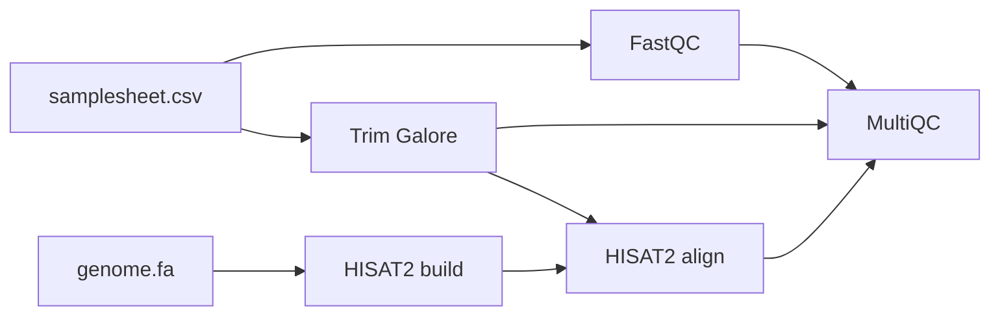

# mini-rnaseq-nf

A small, reproducible RNA-seq pipeline written in **Nextflow DSL2**, with every tool running in its own **Docker** container.

## Pipeline overview



1. **FastQC**: raw read quality control
2. **Trim Galore**: adapter and quality trimming, with post-trimming FastQC
3. **HISAT2 build**: genome index built once from the FASTA file
4. **HISAT2 + samtools**: paired-end alignment to the reference, BAM output
5. **MultiQC**: one aggregated QC report for all samples

## Quick start

Requirements: [Nextflow](https://www.nextflow.io/) (>= 25.10) and [Docker](https://www.docker.com/).

```bash
git clone https://github.com/omarelrhoul-cloud/mini-rnaseq-nf.git
cd mini-rnaseq-nf
nextflow run main.nf -profile docker,test
```

The `test` profile runs the pipeline on the small dataset included in `data/` (about 4 minutes on 2 CPUs).

## Run on your own data

```bash
nextflow run main.nf -profile docker --input samplesheet.csv --fasta genome.fa
```

The samplesheet is a CSV file with one line per sample (paired-end reads):

```csv
sample,fastq_1,fastq_2
SAMPLE1,path/to/SAMPLE1_R1.fastq.gz,path/to/SAMPLE1_R2.fastq.gz
```

| Parameter | Description | Default |
| --- | --- | --- |
| `--input` | Samplesheet (CSV) | required |
| `--fasta` | Reference genome (FASTA) | required |
| `--report_name` | Name of the MultiQC report | `mini_rnaseq` |

## Outputs

| Folder | Content |
| --- | --- |
| `results/fastqc/` | FastQC reports for raw reads |
| `results/trimming/` | Trim Galore reports |
| `results/align/` | One BAM file and one HISAT2 log per sample |
| `results/multiqc/` | Aggregated MultiQC report |

## Test data

Six paired-end RNA-seq samples from ENCODE, subsampled to a small region of human chromosome 20, as distributed with the [Nextflow training material](https://github.com/nextflow-io/training).

## Author

Omar ELRHOUL, bioinformatics engineer.
